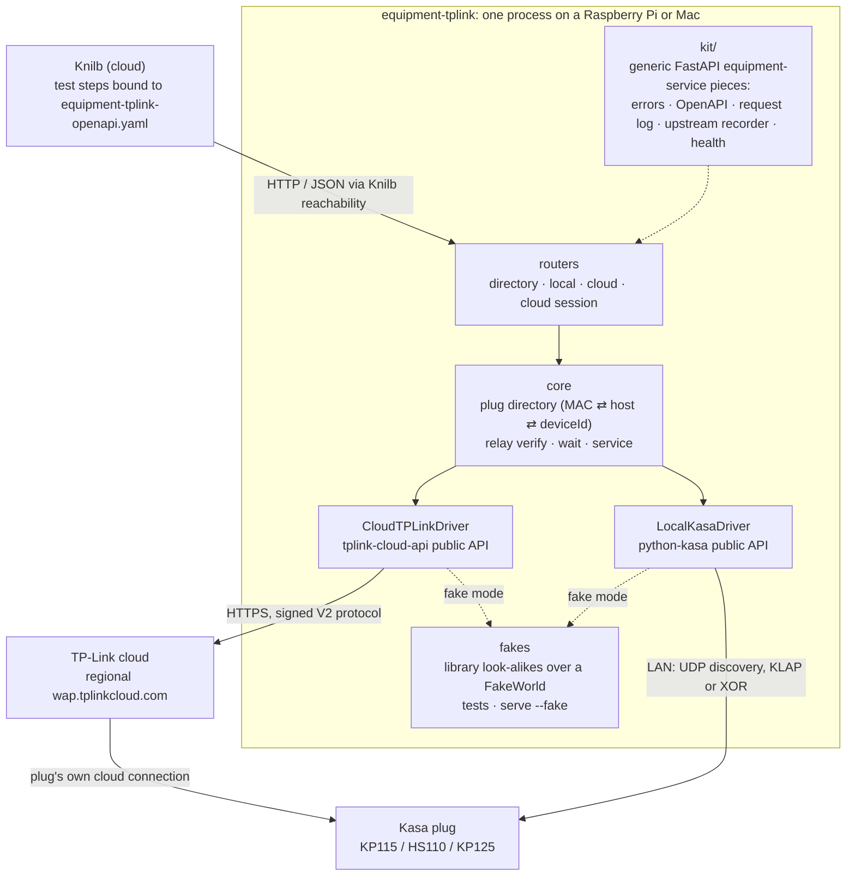

# equipment-tplink — Specification

Version 0.3.0-draft · 2026-09-22 · Owner: Nathan Ota

This file is the contract. `FINDINGS.md` records library and device behaviour we have observed. When they disagree, this file wins for *what* to build.

Changes from 0.2.0:
- Only the libraries' **public APIs** are used, and their limitations are surfaced rather than worked around (§1, §2, §7.5, §7.6).
- Cloud reboot, factory reset and rename are removed because tplink-cloud-api has no public API for them. That brings the total to 26 operations.
- There is no cloud session file and no `cloud-login` CLI. MFA is completed over REST using the library's own callback.
- Plus the src layout, `kit/` separation, extra error codes and test-fake details from the implementation plan.

## 1. Purpose

A Python service that exposes TP-Link Kasa energy-monitoring plugs through a REST API described by OpenAPI 3.1, for the Knilb test platform. The plug plays two roles:

- **Test equipment.** A switchable, metered load. When an energy meter is under test, the plug's reading is the independent reference.
- **Device under test.** Three parts of the TP-Link stack are tested themselves: cloud control of the plug, TP-Link's cloud API behaviour, and the plug's firmware and local protocol.

Two drivers sit behind one contract:

- **local:** `python-kasa` over the LAN.
- **cloud:** `tplink-cloud-api` over TP-Link's account API.

The service wraps these libraries **as they are**:

- It uses only their public APIs and never patches or works around their behaviour.
- Their limitations are part of what's being tested. They're documented in the README ("Known library limitations") and `FINDINGS.md`, and are visible in every response through the `upstream` block (§6.2).
- The service adds no retries of its own. The libraries' internal behaviour, such as python-kasa's transport retries and tplink-cloud-api's token refresh during device listing, is left as it is.

The service never talks to the meter under test; Knilb does that directly, against the meter's own API description.

### 1.1 Block diagram



- **`equipment_tplink.kit`** holds the FastAPI plumbing that any equipment service needs. It must not import TP-Link code, so the next equipment project can copy or extract it.
- **`core` and the drivers** don't import FastAPI.

## 2. Non-goals

- **Fixing or working around python-kasa or tplink-cloud-api.** An operation the public API can't do is left out, or returns `501 unsupported`, and is documented.
- **Authentication on the service.** Decided when Knilb couldn't send credentials. It can now, so this is open to review, but v1 has none (§12).
- **Wi-Fi provisioning.** A person provisions a reset plug with the Kasa app. The API triggers the reset (local) and observes recovery.
- **Firmware updates.** Versions are reported, never changed.
- **Unsupported hardware and protocols:** Tapo devices, power strips (HS300/KP303 outlets), non-metering plugs, lights, cameras, Matter. The cloud driver does read the *Tapo cloud*, because accounts that moved to TP-Link's newer app list their Kasa plugs there (§7.6).
- **Multi-sample or long-running energy capture.** Every energy read is one instantaneous reading.
- **Arbitrary protocol passthrough.**
- **Persistence of any kind.** That includes cloud tokens (§7.6).
- **A UI.** User documentation is the root `README.md`. `docs/` is reserved for later and not created now.

## 3. Runtime and packaging

| Item | Requirement |
|---|---|
| Python | ≥ 3.11 (Raspberry Pi OS Bookworm ships 3.11), developed on 3.12. Ruff `target-version = py311` and mypy `python_version = 3.11` enforce compatibility. |
| Build | `pyproject.toml`, setuptools, src layout (`src/equipment_tplink/`) |
| Dev environment | pipenv. The `Pipfile` installs the package editable, plus the dev tools. |
| Distribution | Package `equipment-tplink`, import name `equipment_tplink`, console script `equipment-tplink` |
| Version | Only `project.version` in `pyproject.toml`, which python-semantic-release bumps. At runtime it's read with `importlib.metadata`. |
| Framework | FastAPI, uvicorn, pydantic v2 |
| Drivers | `python-kasa >= 0.12.0`, `tplink-cloud-api >= 5.2.1, < 6` |
| Config | `python-dotenv` |
| Hosts | Raspberry Pi OS (systemd template unit `deploy/equipment-tplink@.service`) and macOS. There's no container image, because LAN discovery needs the host network. |

CLI (`--env-file PATH` is accepted by every sub-command):

```
equipment-tplink serve     [--host H] [--port P] [--log-level L] [--fake]
equipment-tplink openapi   [--format yaml|json] [-o PATH]     # dumps the spec; no server needed
equipment-tplink discover  [--timeout S] [--target ADDR]      # prints mac, host, model, alias, auth result
equipment-tplink version
```

`pip install . && equipment-tplink serve` must work with no `.env`. Only the cloud endpoints degrade (§7.6).

## 4. Configuration

Precedence: process environment > `--env-file` > `./.env` > defaults. Secret values are never logged.

| Variable | Default | Meaning |
|---|---|---|
| `TPLINK_USERNAME` | — | TP-Link account email. Used for cloud login, and passed to python-kasa as local credentials (KLAP devices require them). |
| `TPLINK_PASSWORD` | — | Account password. |
| `EQUIPMENT_TPLINK_HOST` | `0.0.0.0` | Bind address. |
| `EQUIPMENT_TPLINK_PORT` | `8080` | Bind port. |
| `EQUIPMENT_TPLINK_LOG_LEVEL` | `INFO` | |
| `EQUIPMENT_TPLINK_DISCOVERY_TARGET` | `255.255.255.255` | Broadcast address for LAN discovery. Set the subnet broadcast (e.g. `192.168.1.255`) on hosts with more than one interface. |
| `EQUIPMENT_TPLINK_DISCOVERY_TIMEOUT_S` | `5` | Default discovery duration. |
| `EQUIPMENT_TPLINK_LOCAL_TIMEOUT_S` | `10` | Default per-call timeout, local driver. |
| `EQUIPMENT_TPLINK_CLOUD_TIMEOUT_S` | `20` | Default per-call timeout, cloud driver. |
| `EQUIPMENT_TPLINK_RELAY_SETTLE_MS` | `500` | Default wait before the verify read after a relay command. |

`.env.example` ships with every variable and a comment.

## 5. Plug identity

One physical plug has one identity: its MAC. The canonical form is uppercase and colon-separated (`00:00:5E:00:53:01`).

The `{plug}` path parameter accepts:

| Form | Example | local | cloud |
|---|---|---|---|
| MAC, with `:`, `-`, `.` or no separators, any case | `00-00-5E-00-53-01`, `00005e005301` | yes | yes |
| IPv4 literal | `192.0.2.24` | yes | no |
| Hostname (RFC 1123) | `kp115-bench.lan` | yes | no |
| Cloud `deviceId` (40 hex characters) | `8006A1B2…` | no | yes |

**Classification**, checked in this order:

1. 40 hex characters: a `deviceId`.
2. 12 hex digits once separators are removed: a MAC.
3. A dotted quad: an IPv4 address.
4. Any other valid RFC 1123 name: a hostname.

Anything else, or a form the namespace doesn't accept, is a `400 invalid_plug_ref`. The OpenAPI parameter has no `pattern`, so this 400 is reachable instead of a 422.

**Resolution** (the plug directory):

- **Local, by MAC.** The directory maps MAC → host. It is filled by LAN discovery and by every successful local read. A MAC that isn't in the directory triggers one discovery; if the MAC is still missing, the call returns `404 plug_not_found`. Discovery reads the MAC from the unauthenticated discovery reply, so a plug that fails authentication still resolves.
- **Local, by host.** The host is used as given. Its MAC is learned from the first discovery reply.
- **Cloud.** A MAC or `deviceId` resolves through the account device list. The list is cached for 60 s, with one forced refresh on a miss.
- **Expiry.** Local entries expire after 5 minutes without being seen.

## 6. API

Base path `/v1`. JSON only. Timestamps are RFC 3339 UTC with milliseconds.

### 6.1 Operations

| Method | Path | operationId | Tag |
|---|---|---|---|
| GET | `/v1/health` | `getHealth` | system |
| GET | `/v1/version` | `getVersion` | system |
| GET | `/v1/plugs` | `listPlugs` | directory |
| GET | `/v1/local/plugs` | `discoverLocalPlugs` | local |
| GET | `/v1/local/plugs/{plug}` | `getLocalPlugState` | local |
| GET | `/v1/local/plugs/{plug}/wait` | `waitLocalPlug` | local |
| POST | `/v1/local/plugs/{plug}/relay` | `setLocalPlugRelay` | local |
| GET | `/v1/local/plugs/{plug}/energy` | `getLocalPlugEnergy` | local |
| GET | `/v1/local/plugs/{plug}/info` | `getLocalPlugInfo` | local |
| GET | `/v1/local/plugs/{plug}/schedule` | `getLocalPlugSchedule` | local |
| GET | `/v1/local/plugs/{plug}/settings` | `getLocalPlugSettings` | local |
| PATCH | `/v1/local/plugs/{plug}/settings` | `updateLocalPlugSettings` | local |
| POST | `/v1/local/plugs/{plug}/reboot` | `rebootLocalPlug` | local |
| POST | `/v1/local/plugs/{plug}/factory-reset` | `factoryResetLocalPlug` | local |
| GET | `/v1/cloud/plugs` | `listCloudPlugs` | cloud |
| GET | `/v1/cloud/plugs/{plug}` | `getCloudPlugState` | cloud |
| GET | `/v1/cloud/plugs/{plug}/wait` | `waitCloudPlug` | cloud |
| POST | `/v1/cloud/plugs/{plug}/relay` | `setCloudPlugRelay` | cloud |
| GET | `/v1/cloud/plugs/{plug}/energy` | `getCloudPlugEnergy` | cloud |
| GET | `/v1/cloud/plugs/{plug}/info` | `getCloudPlugInfo` | cloud |
| GET | `/v1/cloud/plugs/{plug}/schedule` | `getCloudPlugSchedule` | cloud |
| GET | `/v1/cloud/plugs/{plug}/settings` | `getCloudPlugSettings` | cloud |
| PATCH | `/v1/cloud/plugs/{plug}/settings` | `updateCloudPlugSettings` | cloud |
| GET | `/v1/cloud/session` | `getCloudSession` | cloud |
| POST | `/v1/cloud/session` | `loginCloud` | cloud |
| DELETE | `/v1/cloud/session` | `logoutCloud` | cloud |

The cloud side has no reboot or factory-reset operation, because tplink-cloud-api offers no public method for either (FINDINGS F10).

FastAPI also serves `/openapi.json`, and `/openapi.yaml` serves the same document as YAML. Neither appears in the document itself.

Query parameters:

- `timeout_s` (number) on every plug operation:

| Where | Meaning | Range | Default |
|---|---|---|---|
| Ordinary plug calls | per-call timeout | 0.5–120 | the driver's value |
| `wait` | length of the wait window | 1–300 | 30 |
| `discoverLocalPlugs` | discovery duration | 1–30 | `EQUIPMENT_TPLINK_DISCOVERY_TIMEOUT_S` |

- `refresh` (boolean, default false) on `listPlugs` and `listCloudPlugs`. It bypasses caches.
- `until` (required) on `wait`: `on | off | online | offline`.

### 6.2 Upstream block

Every plug response, and every error raised by a driver, carries the library calls behind it. One entry is recorded per call into the library, not per wire packet.

```yaml
Upstream:
  driver: enum [local, cloud]
  calls: [UpstreamCall]
  connection: LocalConnection|null

UpstreamCall:
  op: string                       # the library method called, e.g. "update", "turn_on",
                                   # "discover_single", "get_devices", "power_on", "get_sys_info"
  started_at: date-time
  duration_ms: number
  outcome: enum [ok, error, timeout]
  error_code: integer|null         # TP-Link's code, only when the library exposes one
  error_type: string|null          # library exception class, e.g. "AuthenticationError"
  error_message: string|null
  response: object|null            # what the library returned, as a JSON object

LocalConnection:
  host: string
  port: integer|null
  encrypt_type: string|null        # "KLAP", "XOR", …
  login_version: integer|null
```

- `response` is copied from the library's return value:

| Library call | `response` |
|---|---|
| python-kasa `update` | `device.internal_state` |
| python-kasa commands | the returned dict |
| tplink-cloud-api objects | their public attributes |

- Tokens and passwords are removed. Account emails are masked (`n***@example.com`). `token=` query strings are scrubbed from error messages, because library errors can include URLs.
- On `wait`, `upstream` covers only the final poll.

### 6.3 Schemas

```yaml
PlugIdentity:
  mac: string|null                 # canonical; null only for a host that has never answered
  host: string|null
  device_id: string|null
  alias: string|null
  model: string|null               # e.g. "KP115(US)"

PlugState:
  driver: enum [local, cloud]
  plug: PlugIdentity
  is_on: boolean
  on_since: date-time|null
  rssi: integer|null
  observed_at: date-time
  upstream: Upstream

WaitObservation:
  is_on: boolean|null
  online: boolean
  authenticated: boolean|null      # local only: the plug answered but rejected the credentials
  listed: boolean|null             # cloud only: present in the account device list

WaitResult:
  driver, plug
  until: enum [on, off, online, offline]
  satisfied: boolean
  started_at: date-time
  satisfied_at: date-time|null     # start of the first poll that met the condition
  waited_ms: integer
  polls: integer
  poll_errors: integer
  last_observed: WaitObservation
  last_error: ErrorSummary|null
  upstream: Upstream

ErrorSummary: {code: string, message: string}

RelayCommand:
  state: enum [on, off, toggle]
  verify: boolean = true
  settle_ms: integer (0–10000)     # default EQUIPMENT_TPLINK_RELAY_SETTLE_MS

RelayResult:
  driver, plug
  requested: enum [on, off, toggle]
  expected_on: boolean
  sent_at: date-time
  acknowledged_at: date-time
  latency_ms: number
  is_on: boolean|null              # verify read; null when verify=false
  confirmed: boolean|null
  upstream: Upstream

EnergyReading:
  driver, plug
  power_w: number
  voltage_v: number|null
  current_a: number|null
  energy_total_kwh: number|null
  observed_at: date-time
  upstream: Upstream

CloudLink:                         # the plug's own view of its cloud connection (local only)
  bound: boolean
  connected: boolean
  server: string|null
  username_masked: string|null

AccountEntry:                      # the account device list's view (cloud only)
  online: boolean
  region: string|null
  app_server_url: string|null

DeviceInfo:
  driver, plug
  hw_version: string|null
  sw_version: string|null
  has_energy_monitoring: boolean
  cloud_link: CloudLink|null
  account_entry: AccountEntry|null
  upstream: Upstream

RuleTime:
  action: enum [on, off]|null      # null when the plug reports another action
  at: enum [time, sunrise, sunset]|null
  minutes: integer|null            # minutes after local midnight as stored on the plug
  offset_minutes: integer|null     # sunrise/sunset offset, when the library exposes it

ScheduleRule:
  id: string
  name: string|null
  enabled: boolean
  repeat: boolean
  days: [enum [sun, mon, tue, wed, thu, fri, sat]]
  start: RuleTime
  end: RuleTime|null

Schedule: {driver, plug, rules: [ScheduleRule], upstream}

Settings: {driver, plug, alias: string, led_on: boolean, upstream}

SettingsUpdate:                    # at least one field
  alias: string (1–64)
  led_on: boolean

RebootRequest: {delay_s: integer = 1 (1–60)}
FactoryResetRequest: {confirm_mac: string}
ActionAccepted: {driver, plug, action: enum [reboot, factory_reset], accepted_at, upstream}

DiscoveredPlug:
  plug: PlugIdentity
  supported: boolean               # model is KP115, HS110 or KP125
  connection: LocalConnection
  auth: enum [ok, failed, not_attempted]   # not_attempted: the probe reached no auth decision
  auth_error: string|null          # the rejection, or why the probe could not decide
  discovered_at: date-time
LocalPlugList: {target: string, duration_ms: integer, plugs: [DiscoveredPlug]}

CloudPlug:
  plug: PlugIdentity
  supported: boolean
  online: boolean
  sw_version: string|null
  hw_version: string|null
  region: string|null
CloudPlugList: {cached: boolean, fetched_at: date-time, plugs: [CloudPlug], upstream}

DirectoryLocal: {host: string, auth: enum [ok, failed, not_attempted], seen_at: date-time}
DirectoryCloud: {device_id: string, online: boolean, seen_at: date-time}
DirectoryEntry: {mac, alias, model, local: DirectoryLocal|null, cloud: DirectoryCloud|null}
PlugDirectory:
  plugs: [DirectoryEntry]
  local_error: ErrorSummary|null   # set when a refresh's discovery failed
  cloud_error: ErrorSummary|null   # set when a refresh's cloud list failed or cloud isn't ready

CloudState: enum [not_configured, authenticated, mfa_required, login_required, error]
CloudSession:
  state: CloudState
  username_masked: string|null
  logged_in_at: date-time|null
  last_error: ErrorSummary|null
CloudLoginRequest: {mfa_code: string|null}

Health:
  status: enum [ok]
  version: string
  local: {status: enum [ready], discovery_target: string, plugs_known: integer}
  cloud: {status: CloudState, last_error: ErrorSummary|null}

Version: {version, python, python_kasa, tplink_cloud_api: string}

Error:
  code: string                     # §7.4
  message: string
  driver: enum [local, cloud, none]
  plug: PlugIdentity|null
  upstream: Upstream|null
  detail: object|null
```

Every operation has exactly one success schema; there are no `oneOf` responses.

## 7. Behaviour

### 7.1 Relay

1. For `toggle`, read the state first; `expected_on` is its inverse. Otherwise `expected_on` follows `state`.
2. Send the command: python-kasa `turn_on`/`turn_off`, or tplink-cloud-api `power_on`/`power_off`.
3. If `verify` is set, sleep for `settle_ms`, read the state, and set `confirmed = (is_on == expected_on)`.
4. A mismatch still returns **200**; Knilb asserts on `confirmed`. There are no service retries.

To measure cloud-to-plug latency: send `setCloudPlugRelay` with `verify=false`, then call `waitLocalPlug?until=on`. Compare `satisfied_at` with `sent_at`.

### 7.2 Wait

`GET …/wait` polls until the condition holds or the window closes.

- **Poll interval.** Local polls run every 100 ms and cloud polls every 1000 ms, measured from the start of each poll. Each poll's timeout is the smaller of the call timeout and the time left in the window.
- **What each condition means:**

| `until` | local | cloud |
|---|---|---|
| `on` / `off` | state read; errors are counted and polling continues | state read (`get_sys_info`); errors are counted |
| `online` | the plug **answered**: the read succeeded (`authenticated=true`) or the plug rejected the credentials (`authenticated=false`) | the account device list shows the plug with `status == 1` |
| `offline` | the read failed with `device_unreachable` or `timeout` | the plug is listed with another status, or is missing from the list |

- **Why local `online` counts an auth rejection.** Reboot recovery stays measurable when a plug rejects authentication, as the bench plug did before FINDINGS F1 was fixed upstream.
- **Rediscovery.** On a local wait addressed by MAC, discovery re-runs at most every 5 s while the plug can't be reached or resolved. During a wait, an unresolved MAC counts as unreachable, not 404.
- **Result.** The condition is checked immediately. The response is always **200**: `satisfied=false` at the deadline is a result, not an error.
- **HTTP timeouts.** Keep `timeout_s` under the HTTP timeout of Knilb's reachability layer.

### 7.3 Timeouts

- Every driver call runs inside `async with asyncio.timeout(...)`.
- Blocking library calls (tplink-cloud-api's `login` and `get_devices`) run in a worker thread. A timed-out thread can't be cancelled, and finishes in the background.

### 7.4 Errors

Every error uses the `Error` schema, including FastAPI's validation errors and Starlette's 404 and 405.

| HTTP | code | driver | When |
|---|---|---|---|
| 400 | `invalid_plug_ref` | none | `{plug}` doesn't parse, or its form isn't accepted by the namespace |
| 404 | `plug_not_found` | local, cloud | MAC not found by discovery; MAC or `deviceId` not in the account list |
| 404 | `not_found` | none | no such route |
| 405 | `method_not_allowed` | none | wrong method for the route |
| 409 | `confirmation_mismatch` | none | factory-reset `confirm_mac` ≠ the resolved plug's MAC |
| 409 | `mfa_not_pending` | cloud | `mfa_code` sent while no login is waiting for one |
| 422 | `validation_error` | none | request body or query validation |
| 500 | `internal_error` | none | an unexpected exception in the service |
| 501 | `unsupported` | local, cloud | the plug model or the library doesn't support the operation (e.g. energy without an emeter, cloud alias change) |
| 502 | `device_unreachable` | local | connection refused, no route or reset |
| 502 | `device_auth_failed` | local | the plug rejected the credentials (python-kasa `AuthenticationError`, see F1) |
| 502 | `device_error` | local, cloud | any other python-kasa error, or a library result without the value asked for |
| 502 | `device_offline` | cloud | a device call returned no result and the account list shows the plug offline |
| 502 | `cloud_error` | cloud | tplink-cloud-api raised, or a device call returned no result while the plug is listed online (F11) |
| 503 | `cloud_not_configured` | cloud | no credentials configured |
| 503 | `cloud_login_required` | cloud | not logged in: no login yet, wrong password, refresh failed, or logged out |
| 503 | `cloud_mfa_required` | cloud | the login is waiting for an MFA code; send it with `loginCloud` |
| 504 | `timeout` | local, cloud | the operation exceeded `timeout_s` |

### 7.5 Local driver (python-kasa public API)

- **Connection.**
  - A plug seen in discovery is reused from the discovery result. Any other host goes through `Discover.discover_single(host, credentials=…, timeout=…)`.
  - The driver caches one `Device` per MAC. A cached device expires after 5 idle minutes and is disconnected on eviction. It is also dropped after any connection error, so the next call starts fresh.
- **Reads** call `update()` and then use the public properties:
  - state: `is_on`, `on_since`, `rssi`, `alias`, `model`, `mac`, `sys_info`;
  - modules: `Module.Energy`, `Module.Led`, `Module.IotSchedule` and `Module.IotCloud`.
- **Commands:** `turn_on`, `turn_off`, `set_alias`, `Led.set_led`, `reboot(delay)` and `factory_reset()`.
- **Credentials.** When `TPLINK_USERNAME` and `TPLINK_PASSWORD` are set, they are passed as python-kasa `Credentials`.
- **Library behaviour, as-is:**
  - python-kasa picks the transport. On python-kasa 0.10.2 the consequence was F1.
  - It retries transport errors internally (F18).
  - It wraps command errors as `KasaException("Communication error…")` and hides IOT `err_code` (F17).
- **Error classification.** The driver walks the exception chain:

| Found in the chain | Error code |
|---|---|
| `AuthenticationError` | `device_auth_failed` |
| kasa or builtin `TimeoutError` | `timeout` |
| connection errors or `OSError` | `device_unreachable` |
| `UnsupportedDeviceError` | `unsupported` |
| anything else | `device_error` |

- **Discovery.**
  - It calls `Discover.discover(target=…, discovery_timeout=…, credentials=…, on_unsupported=<recorder>)` without an `on_discovered` callback (F19).
  - It then runs a bounded, concurrent `update()` on each device to set `auth`.
  - `supported` is true for the models KP115, HS110 and KP125.
- **`info.cloud_link`** comes from the `IotCloud` module.
- **`upstream.connection`** comes from `device.config.connection_type`, which gives `encrypt_type` and `login_version`.

### 7.6 Cloud driver (tplink-cloud-api public API)

- **Manager.** `TPLinkDeviceManager(username, password, prefetch=False, cache_devices=False, include_tapo=True, term_id=<uuid5 of host name and username>, mfa_callback=…)`. The constructor logs in to the Kasa cloud and the Tapo cloud; `get_devices` lists both and removes duplicates. Both calls block, so they run in a worker thread.
- **Token check.** After the constructor returns, the public `get_token()` and `get_tapo_token()` show which clouds are logged in. If neither has a token, the login fails with `cloud_login_required` (FINDINGS F23). A missing Tapo token alone is not an error, because the library swallows Tapo login failures (F7).
- **MFA over REST.** The `mfa_callback` runs inside the login thread:
  1. It sets the state to `mfa_required`.
  2. It waits up to 300 s for `loginCloud {mfa_code}`, and returns that code to the library.
  3. If the library then rejects the code, the login fails and the state becomes `login_required`, so a fresh `loginCloud` is needed. A timeout does the same.
- **`loginCloud`** starts a login, or supplies the code to the login that is waiting. It returns once the login finishes or asks for MFA.
- **Startup.** If credentials are set, a login starts in the background. It is never fatal.
- **No persistence.** The session can't be persisted using only the public API (F16). After a restart the service logs in again, and an MFA account needs a new code.
- **Device list.** The device list is cached for 60 s (`refresh=true` bypasses the cache). Tokens refresh only inside `get_devices` (the library's own behaviour), so an expired token clears up at the next list refresh (F13).
- **Device calls** use the device objects from the latest list:

| Operation | Library method |
|---|---|
| state | `get_sys_info` |
| relay | `power_on` / `power_off` |
| energy | `get_power_usage_realtime` |
| schedule | `get_schedule_rules` |
| LED | `set_led_state` |

- **Results.** A `None` result maps to `device_offline` if the account list shows the plug offline, and to `cloud_error` otherwise (F11). Energy on a device without an emeter returns `501`.
- **What the library can't do.** Rename isn't available: `updateCloudPlugSettings` with an `alias` returns `501 unsupported`. Reboot and factory reset aren't offered (F10).
- **`logoutCloud`** drops the manager and cancels any waiting MFA. The state becomes `login_required`.

### 7.7 Reboot and factory reset (local only)

- Both return **202** once python-kasa's call returns. Recovery is measured with `wait?until=offline`, then `wait?until=online`.
- Factory reset requires `confirm_mac` to match the resolved plug's MAC.
- After a reset, a person re-provisions the plug with the Kasa app. Tests then observe `discoverLocalPlugs`, `wait?until=online`, `info.cloud_link` and `listCloudPlugs`.

### 7.8 Logging

A pure ASGI middleware writes one JSON line per request with these fields:

- `ts`, `request_id`, `method`, `path`, `operation_id`
- `driver`, `plug` (the MAC, when known)
- `outcome` (`ok` or the error code), `status`
- `latency_ms`, `upstream_ms`

The request ID comes from an inbound `X-Request-Id`, or is generated. It is always echoed in the response.

## 8. Driver contract

`core/service.py` owns resolution, relay verification, the wait loop, timeouts, per-plug locks and assembling the upstream block. Drivers implement:

```python
class PlugDriver(Protocol):
    kind: Literal["local", "cloud"]

    async def list_plugs(self, *, timeout: float, refresh: bool) -> list[ListedPlug]: ...
    async def resolve(self, ref: PlugRef, *, timeout: float) -> PlugIdentity: ...
    async def read_state(self, plug: PlugIdentity, *, timeout: float) -> StateReading: ...
    async def probe(self, plug: PlugIdentity, *, timeout: float) -> WaitObservation: ...
    async def set_relay(self, plug: PlugIdentity, on: bool, *, timeout: float) -> None: ...
    async def read_energy(self, plug: PlugIdentity, *, timeout: float) -> EnergyValues: ...
    async def read_info(self, plug: PlugIdentity, *, timeout: float) -> InfoValues: ...
    async def read_schedule(self, plug: PlugIdentity, *, timeout: float) -> list[ScheduleRule]: ...
    async def read_settings(self, plug: PlugIdentity, *, timeout: float) -> SettingsValues: ...
    async def write_settings(self, plug: PlugIdentity, *, alias: str | None,
                             led_on: bool | None, timeout: float) -> None: ...
    async def reboot(self, plug: PlugIdentity, *, delay_s: int, timeout: float) -> None: ...
    async def factory_reset(self, plug: PlugIdentity, *, timeout: float) -> None: ...
```

- **Library entry points are injected.** `LocalKasaDriver` receives `discover` and `discover_single` (python-kasa's by default). `CloudTPLinkDriver` receives a `manager_factory` (`TPLinkDeviceManager` by default).
- **The fakes (`equipment_tplink/fakes/`)** are look-alikes of exactly those library surfaces, backed by one clock-driven `FakeWorld`:
  - `FakeKasaDevice` with fake `discover` and `discover_single`, which raise real kasa exception types;
  - `FakeDeviceManager` and `FakeCloudDevice`, which raise real tplinkcloud exception types.
- **Fake mode runs the real drivers.** `serve --fake` and the test suite both do this. Cloud commands reach the fake plug after a configurable latency. A reboot takes the plug offline for 2 s. A factory reset takes it offline for 10 s, after which it returns on a new host.

## 9. OpenAPI requirements

- OpenAPI **3.1.0**. `info.title = "equipment-tplink"`, and `info.version` is the package version.
- `operationId`s exactly as in §6.1. Tags `system`, `directory`, `local` and `cloud`, each with a description.
- Every response has a schema and at least one example. This covers the success response and every error status the operation can return.
- `servers: [{url: "http://{host}:{port}", variables: {host: {default: localhost}, port: {default: "8080"}}}]`.
- No `securitySchemes`. `info.description` notes that there is no authentication.
- The committed artifact is `equipment-tplink-openapi.yaml`, produced by `equipment-tplink openapi`. CI fails if `openapi-spec-validator` rejects it, or if regenerating it changes anything other than `info.version`. That field is exempt because python-semantic-release bumps the version after merge.

## 10. Tests

- **pytest only.** Coverage comes from pytest-cov with **branch coverage, and the build fails below 90%**.
- **API tests** run `create_app(fake=True)` under `TestClient`. Every response body is validated against the generated OpenAPI document.
- **Unit tests** cover:
  - identity parsing;
  - the relay, including toggle and mismatch;
  - wait: each `until`, the deadline, poll errors, offline because the plug is missing from the list, rediscovery;
  - every §7.4 code;
  - redaction;
  - config precedence and startup with no `.env`;
  - the cloud MFA flow;
  - the CLI, run in-process.
- **Contract tests** check that:
  - the document is a valid spec;
  - the operationIds equal §6.1;
  - every response has an example, and every example validates;
  - the committed YAML hasn't drifted.
- **Library conformance tests** run the drivers against real library objects: python-kasa `IotPlug` with a fake protocol, and a real `TPLinkDeviceManager` with patched HTTP. They catch fakes that have drifted from the libraries.
- **Hardware tests** (`-m hardware`, skipped unless `TPLINK_USERNAME`, `TPLINK_PASSWORD`, `TEST_PLUG_MAC`, and `TEST_LOCAL=1` for local, are set):
  1. read state
  2. turn on and confirm
  3. read energy, expect `power_w > 0` with a lamp plugged in
  4. turn off
  5. read energy, expect `power_w < 1`
  6. local only: reboot, then wait until `offline` and until `online`

  A cross-driver test sends a cloud `on` and expects a local `wait?until=on`. Factory reset is marked `-m destructive` and run manually only.

## 11. Findings

`FINDINGS.md` records where the libraries or devices differ from their documentation or from expectations. The README's "Known library limitations" section summarises the ones users will notice.

## 12. Security

The service has no authentication, by decision. It controls mains power and can factory-reset plugs:

- Run it only on a trusted LAN, behind Knilb's reachability layer. Never expose it to the internet.
- Credentials live only in the environment or `.env`. Responses remove tokens and mask account emails.

## 13. Repository layout

```
pyproject.toml  Pipfile  Pipfile.lock  Makefile  .python-version  .env.example
README.md  SPEC.md  FINDINGS.md  CHANGELOG.md (generated)  LICENSE
equipment-tplink-openapi.yaml
deploy/equipment-tplink@.service               # systemd template unit, instance = user
.github/workflows/continuous-integration.yml  release.yml
src/equipment_tplink/
  __init__.py  __main__.py  cli.py  config.py  app.py
  kit/      errors.py  openapi.py  request_log.py  timestamps.py  upstream.py
            redact.py  clock.py  system.py          # no TP-Link imports
  core/     models.py  errors.py  identity.py  directory.py  rules.py
            service.py                               # resolution, relay verify, wait
  drivers/  base.py  local.py  cloud.py  cloud_session.py
  fakes/    world.py  kasa.py  cloud.py
  routers/  plugs.py  directory.py  cloud_session.py  examples.py
tests/  unit/  contract/  conformance/ (M2, M3)  hardware/ (M2, M3)
```

`docs/` is reserved for future user documentation. It isn't created until it's needed; until then, the root README is the user documentation.

## 14. Milestones

Each milestone ships as its own PR. Before opening a PR: run a code review, fix what it finds, and pass `make check`.

1. **Contract, core and fakes.** Packaging, CI, the kit, core, both drivers running on the fakes, the routers, the CLI (`serve`, `openapi`, `version`) and the OpenAPI artifact.
2. **Cloud.** Conformance tests against a real `TPLinkDeviceManager`, and the cloud hardware tests.
3. **Local.** Conformance tests against a real python-kasa `IotPlug`, the `discover` CLI, and the local, cross-driver and destructive hardware tests.
4. **Docs and deploy.** The README (from a blank Pi to `curl /v1/health`, plus the known library limitations), the systemd unit and `.env.example`.

## 15. Acceptance criteria

1. After `pip install .`, `equipment-tplink serve` starts with no `.env`, and `/v1/health` reports cloud `not_configured`.
2. `equipment-tplink openapi` emits a valid 3.1 document that matches the committed file, except for `info.version`.
3. All 26 operations exist with their operationIds, and a unit test reaches every error code.
4. `serve --fake` lets Knilb exercise the full contract without hardware.
5. The cloud hardware scenario passes on the bench KP115.
6. The local hardware scenario passes on the bench KP115 (python-kasa ≥ 0.12.0, which contains the KLAP v2 fix, F1).
7. `make check` is green, with branch coverage ≥ 90%.

## 16. Open items

- Whether tplink-cloud-api's `set_led_state` works on real hardware (F14).
- Whether a factory-reset plug stays in the account device list.
